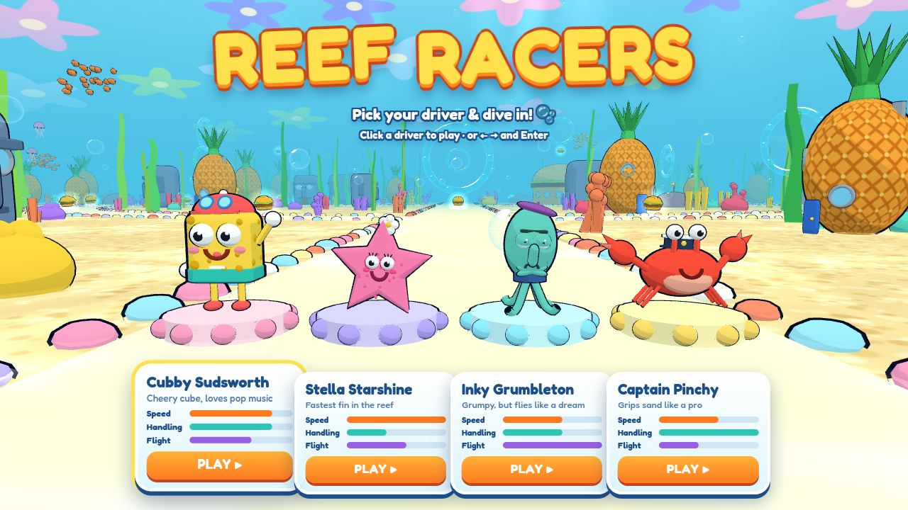
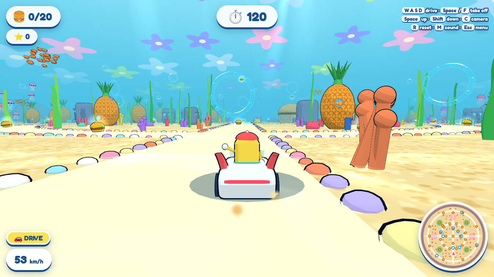
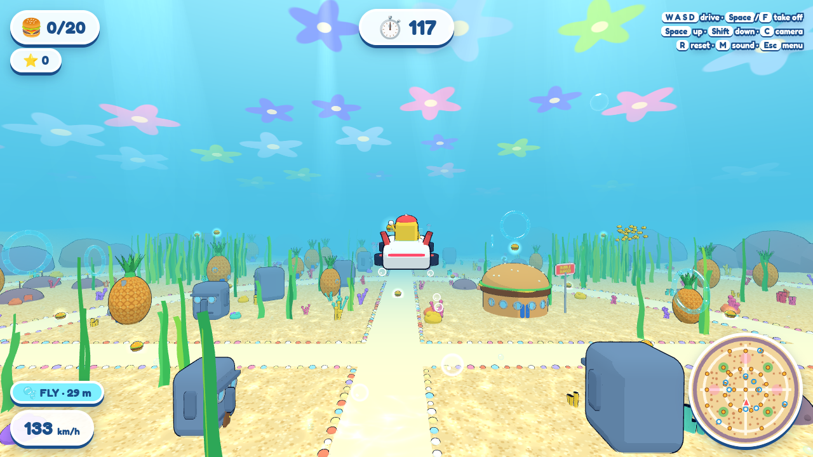

# 🫧 Reef Racers

A bright cartoon underwater racing mini-game that runs in the browser. Pick a driver, cruise the sand roads of a coral town in the **AquaVolt** electric car, then take off and fly. Collect golden burgers, fly through bubble rings, and dodge the bouncy jellyfish before the clock runs out.

**▶ Play:** https://andremka030.github.io/reef-racers/

Built with AI in public by [@worldmarketcup](https://x.com/worldmarketcup). One self-contained `index.html` (three.js, all assets procedural).

## Drivers
| Driver | Speed | Handling | Flight |
|---|---|---|---|
| Cubby Sudsworth (cheery cube) | 4 | 4 | 3 |
| Stella Starshine (pink starfish) | 5 | 2 | 3 |
| Inky Grumbleton (grumpy squid) | 3 | 3 | 5 |
| Captain Pinchy (red crab) | 3 | 5 | 2 |

## Controls
- **W A S D / arrows** — drive and steer
- **Space / F** — take off (F again lands back to driving)
- **Space** — climb · **Shift** — descend
- **C** — camera · **R** — reset · **M** — mute · **Esc** — menu
- Touch buttons appear on phones and tablets.

**Goal:** collect 20 🍔 in 120 seconds. Bubble rings give +250 points and +6 s.
